# AI-Based TB-COVID Co-Infection Risk Analysis Using Machine Learning, AIS, and PSO

## Project Overview

This project presents an AI-based approach for analyzing Tuberculosis (TB) and COVID-19 co-infection screening patterns across Indian states and Union Territories.

The system uses Machine Learning (ML), Artificial Immune System (AIS), and Particle Swarm Optimization (PSO) techniques to analyze screening coverage, detected co-infection cases, and differences between public and private healthcare facilities.

The primary objective is to classify state-level TB-COVID screening performance into Low, Moderate, and High categories and compare the performance of different machine learning algorithms.

AIS and PSO are used to optimize feature selection and Random Forest hyperparameters to investigate whether optimization improves classification performance.

The project also generates visualizations, prediction results, evaluation reports, and reusable trained models.

> **Important:** This is an exploratory state-level screening performance analysis project. It does not diagnose TB or COVID-19, predict individual patient infection risk, or provide clinical recommendations.

---

## Project Visualization

The following graph compares the classification performance of machine learning models evaluated in the AIS experiment.

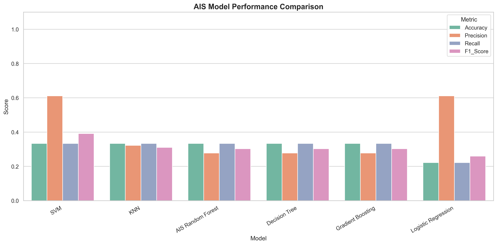

**Figure: AIS-Based Machine Learning Model Performance Comparison**

The graph presents four evaluation metrics:

- Accuracy
- Precision
- Recall
- F1-Score

These metrics help compare the classification performance of AIS-optimized Random Forest against other machine learning models.

---

## Project Objectives

The main objectives of this project are:

1. Analyze TB-COVID screening data across Indian states and Union Territories.
2. Study screening performance in public and private healthcare facilities.
3. Examine observed TB-COVID co-infection detection patterns.
4. Classify state-level screening performance into Low, Moderate, and High categories.
5. Develop machine learning classification models.
6. Apply Artificial Immune System optimization for feature selection and hyperparameter tuning.
7. Apply Particle Swarm Optimization to improve model configurations.
8. Compare baseline, AIS, and PSO classification performance.
9. Generate correlation heatmaps and performance comparison graphs.
10. Export prediction results, evaluation metrics, and trained models.

---

## Problem Statement

Tuberculosis and COVID-19 are infectious diseases that create important public health challenges.

TB patients may also experience COVID-19 infection, making screening and co-infection monitoring important for healthcare planning.

Screening coverage and detection patterns can vary between states and healthcare sectors.

Traditional analysis of screening statistics may not easily reveal complex relationships among screening volumes, detection percentages, and overall screening performance.

This project investigates whether machine learning and nature-inspired optimization techniques can identify useful patterns in state-level TB-COVID screening data.

The proposed system provides an exploratory analytical framework for comparing screening performance and identifying potential differences in screening coverage across geographic regions.

---

## Dataset Information

**Dataset Name:** `2.13_TB_COVID.csv`

**Dataset Type:** Structured CSV

**Domain:** Healthcare Analytics

**Geographical Coverage:** Indian States and Union Territories

**Original Dataset Records:** 37

**Original Dataset Columns:** 13

### Dataset Attributes

| Attribute | Description |
|---|---|
| State_UT | State or Union Territory |
| Public_Screened_Count | Number of TB patients screened in public healthcare facilities |
| Public_Screening_Percentage | Public-sector screening coverage percentage |
| Private_Screened_Count | Number of TB patients screened in private healthcare facilities |
| Private_Screening_Percentage | Private-sector screening coverage percentage |
| Total_Screened_Count | Total number of screened patients |
| Total_Screening_Percentage | Overall screening coverage percentage |
| Public_Detected_Count | Detected TB-COVID co-infection cases in public facilities |
| Public_Detection_Percentage | Public-sector detection percentage |
| Private_Detected_Count | Detected TB-COVID co-infection cases in private facilities |
| Private_Detection_Percentage | Private-sector detection percentage |
| Total_Detected_Count | Total detected co-infection cases |
| Total_Detection_Percentage | Overall co-infection detection percentage |

### Data Preprocessing

The following preprocessing steps are performed:

1. Load the dataset using Pandas.
2. Standardize column names.
3. Convert numerical attributes into numeric format.
4. Identify missing values.
5. Remove records with missing target information.
6. Exclude aggregate India-level rows from state-level classification.
7. Apply missing-value imputation within the machine learning pipeline.
8. Encode screening performance categories.
9. Split the dataset into training and testing subsets.
10. Apply feature selection using AIS and PSO.

Missing feature values are imputed using the median calculated from the training data.

---

## Target Variable

The classification target is:

`Screening_Performance_Category`

The target is generated from the overall screening coverage percentage.

| Category | Screening Coverage |
|---|---|
| Low | Below 50% |
| Moderate | 50% to below 80% |
| High | 80% and above |

These are illustrative project-defined screening categories rather than officially validated clinical thresholds.

The classification system predicts screening performance categories, not the probability of a patient developing TB-COVID co-infection.

---

## Technologies Used

### Programming Language

- Python

### Data Analysis

- Pandas
- NumPy

### Machine Learning

- Scikit-learn

### Optimization Algorithms

- Artificial Immune System (AIS)
- Clonal Selection Algorithm (CLONALG)
- Particle Swarm Optimization (PSO)

### Deep Learning

- TensorFlow
- Keras

### Data Visualization

- Matplotlib
- Seaborn

### Model Storage

- Joblib
- Pickle
- HDF5
- YAML
- JSON

### Development Environments

- Jupyter Notebook
- Visual Studio Code
- Python IDE

---

## Machine Learning Algorithms

The project compares the following classification algorithms.

### 1. Random Forest Classifier

Random Forest is an ensemble learning algorithm that combines multiple decision trees.

It is used as the primary classifier for baseline, AIS, and PSO experiments.

Advantages:

- Handles nonlinear relationships.
- Supports feature importance analysis.
- Works with numerical data.
- Can reduce overfitting compared with individual decision trees.

### 2. Decision Tree Classifier

Decision Tree creates classification rules by recursively dividing the feature space.

Advantages:

- Easy to interpret.
- Supports nonlinear decision boundaries.
- Provides understandable classification rules.

### 3. Logistic Regression

Logistic Regression provides a statistical classification baseline.

Advantages:

- Computationally efficient.
- Easy to implement.
- Useful for comparing more complex models.

### 4. Support Vector Machine

Support Vector Machine identifies decision boundaries between screening performance categories.

Advantages:

- Supports nonlinear classification using kernels.
- Useful for small datasets.
- Can model complex decision boundaries.

### 5. K-Nearest Neighbors

KNN predicts categories based on nearby observations in the feature space.

Advantages:

- Simple classification approach.
- No complex training procedure.
- Useful as a baseline algorithm.

### 6. Gradient Boosting Classifier

Gradient Boosting combines sequentially trained decision trees.

Advantages:

- Learns nonlinear patterns.
- Can model complex feature interactions.
- Provides an additional ensemble learning baseline.

### 7. Artificial Neural Network

An Artificial Neural Network is included in the initial model training experiment.

The network uses fully connected layers and nonlinear activation functions.

The trained neural network is saved in HDF5 format.

Due to the small dataset, neural network results should be interpreted cautiously.

---

## Artificial Immune System (AIS)

### Overview

Artificial Immune System is a nature-inspired optimization technique based on mechanisms observed in biological immune systems.

This project implements the Clonal Selection Algorithm (CLONALG) for feature selection and Random Forest hyperparameter optimization.

### AIS Workflow

1. Initialize a population of antibodies.
2. Represent feature subsets and hyperparameters using antibodies.
3. Evaluate antibody fitness using cross-validation.
4. Select the highest-fitness antibodies.
5. Clone selected antibodies.
6. Apply mutation to generate new candidate solutions.
7. Replace weaker solutions.
8. Repeat optimization across generations.
9. Select the best feature subset and hyperparameters.
10. Train the optimized Random Forest classifier.

### AIS Optimization Parameters

| Parameter | Value |
|---|---|
| Population Size | 12 |
| Generations | 12 |
| Top Antibodies | 4 |
| Clones per Antibody | 4 |
| New Random Antibodies | 3 |
| Fitness Metric | Macro F1-Score |
| Cross-Validation | Up to 3 stratified folds |

### AIS Fitness Function

The AIS fitness function combines classification performance and a feature selection penalty.

Fitness = Mean Cross-Validated Macro F1 - Feature Penalty

The feature penalty encourages the algorithm to select smaller feature subsets.

### AIS Advantages

- Performs automatic feature selection.
- Optimizes classifier hyperparameters.
- Explores different model configurations.
- Reduces unnecessary input features.
- Provides a systematic optimization process.

### AIS Visualization


The comparison graph shows the evaluation metrics of the AIS-optimized Random Forest and other classification models.

### Additional AIS Graphs

**Accuracy Comparison**

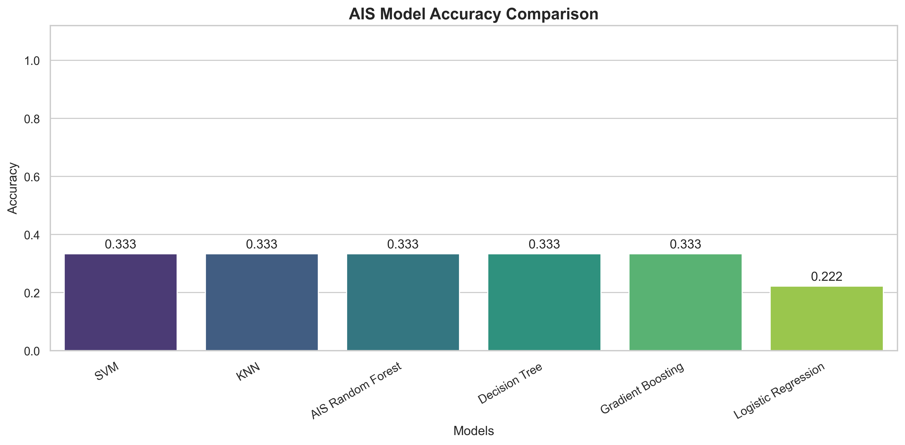

**Correlation Heatmap**

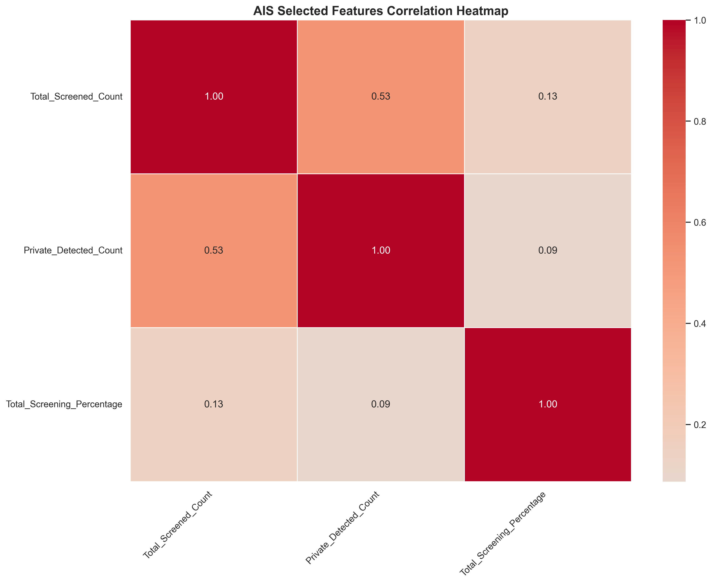

**Optimization Convergence**

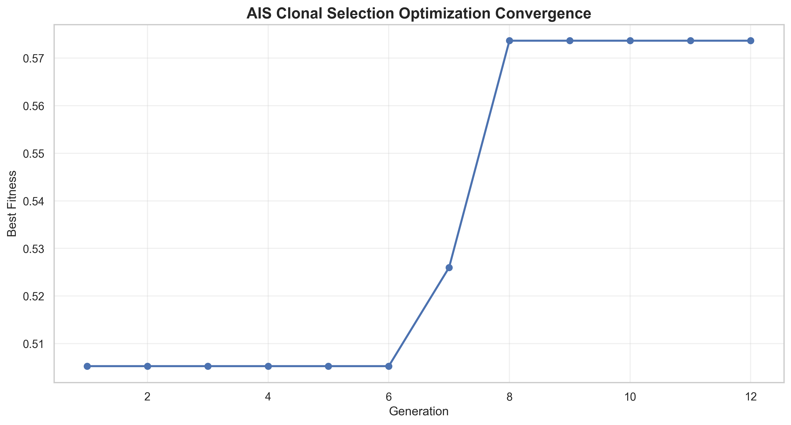

**Actual vs Predicted Results**

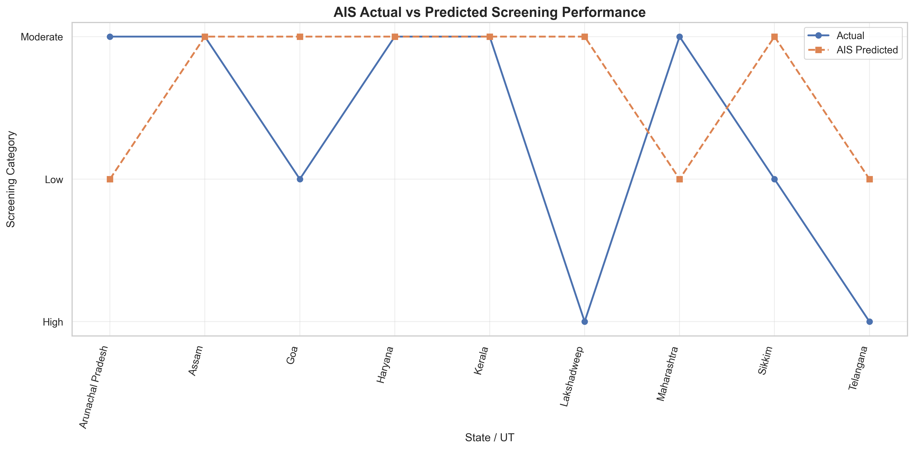

**State-Level Predictions**

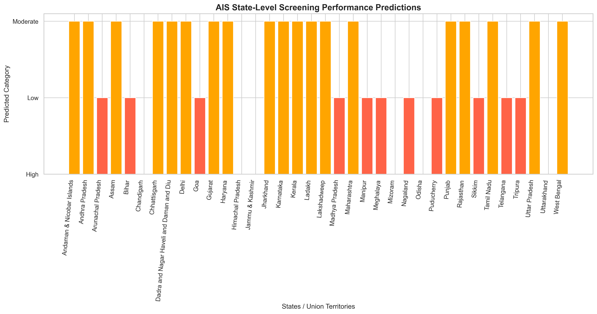

**Feature Importance**

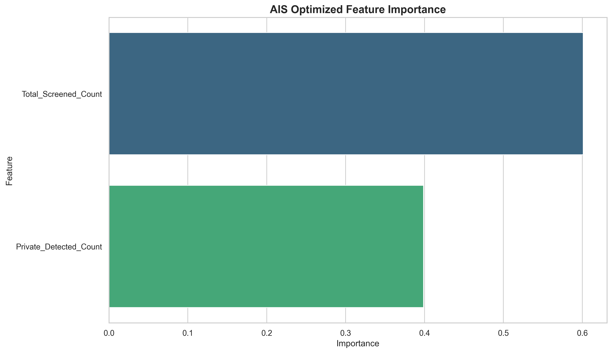

---

## Particle Swarm Optimization (PSO)

### Overview

Particle Swarm Optimization is a population-based optimization technique inspired by the collective movement of birds and fish.

PSO uses a collection of particles that search for optimal solutions by updating their positions and velocities.

In this project, PSO is used for:

- Feature selection.
- Random Forest hyperparameter optimization.
- Searching for improved model configurations.

### PSO Workflow

1. Initialize a swarm of particles.
2. Represent feature selection decisions and hyperparameters as particle positions.
3. Evaluate particle fitness.
4. Update each particle's personal best solution.
5. Identify the global best solution.
6. Update particle velocity.
7. Update particle position.
8. Repeat until the maximum number of iterations is reached.
9. Select the best particle.
10. Train the optimized classifier.

### PSO Parameters

| Parameter | Value |
|---|---|
| Number of Particles | 12 |
| Number of Iterations | 15 |
| Inertia Weight | 0.7 |
| Cognitive Coefficient | 1.5 |
| Social Coefficient | 1.5 |
| Fitness Metric | Macro F1-Score |
| Cross-Validation | Up to 3 stratified folds |

### PSO Velocity Update

The particle velocity is updated using:

v(t+1) = w*v(t) + c1*r1*(pbest-x) + c2*r2*(gbest-x)

Where:

- w = Inertia weight
- c1 = Cognitive coefficient
- c2 = Social coefficient
- r1, r2 = Random values
- pbest = Personal best position
- gbest = Global best position
- x = Current particle position

### PSO Advantages

- Searches a continuous optimization space.
- Supports feature selection and parameter tuning.
- Uses personal and global best solutions.
- Can explore multiple candidate configurations.
- Provides convergence information.

### PSO Visualizations

**Model Comparison**

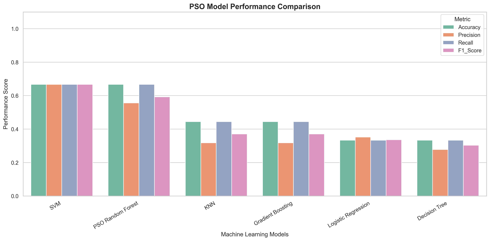

**Accuracy Comparison**

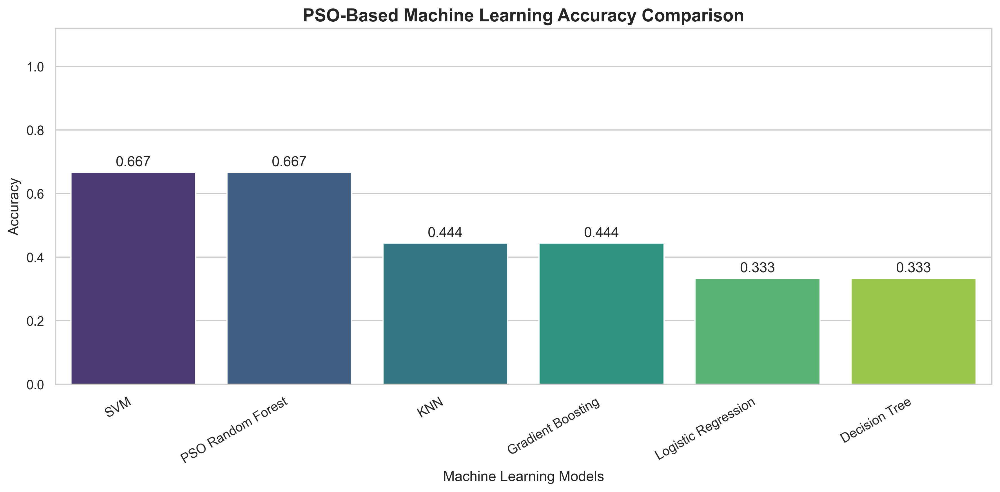

**Optimization Convergence**

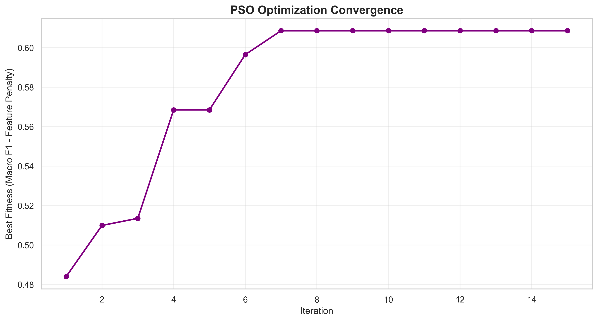

**Correlation Heatmap**

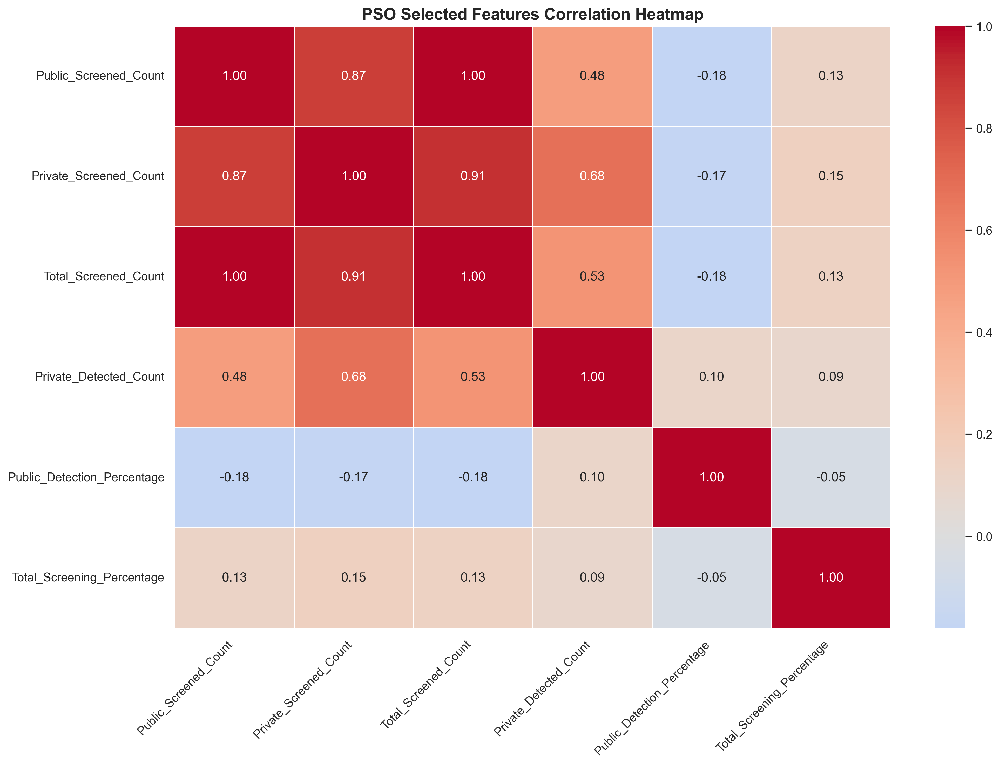

**Actual vs Predicted Results**

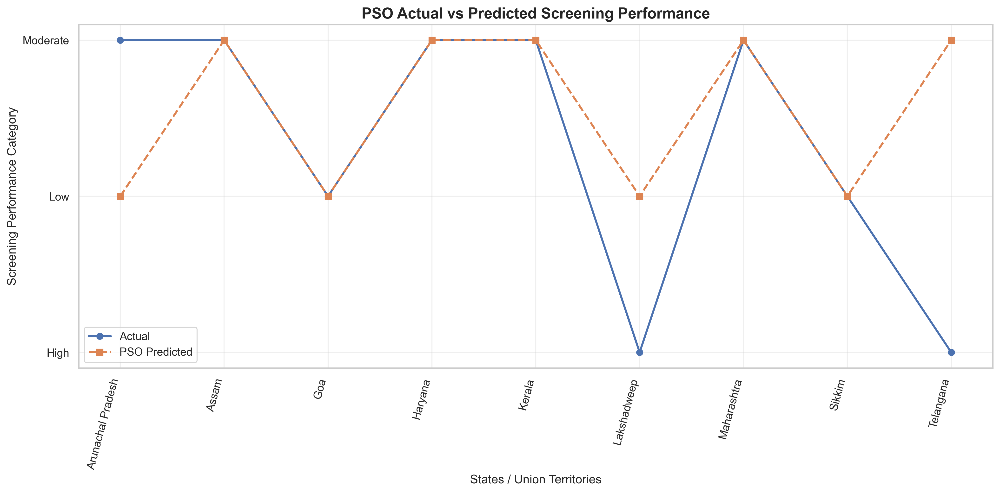

**State-Level Predictions**

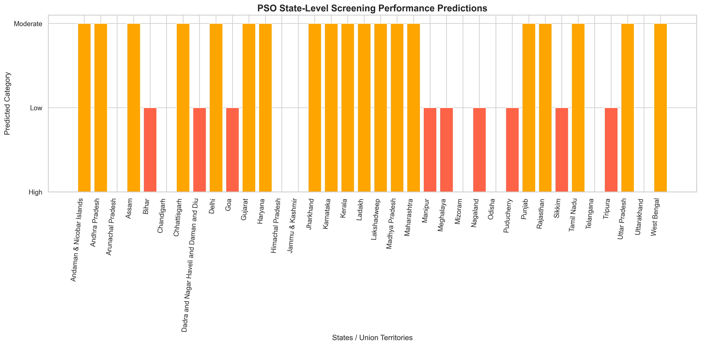

---

## Project Architecture

```text
TB-COVID Dataset
       |
       v
Data Collection
       |
       v
Data Cleaning and Preprocessing
       |
       v
Exploratory Data Analysis
       |
       v
Screening Performance Category Creation
       |
       v
Train-Test Split
       |
       +-------------------------+
       |                         |
       v                         v
Baseline Machine Learning   Optimization
       |                         |
       |                 +-------+-------+
       |                 |               |
       |                 v               v
       |                AIS             PSO
       |                 |               |
       |                 v               v
       |          Feature Selection  Feature Selection
       |                 |               |
       |                 v               v
       |          Parameter Tuning   Parameter Tuning
       |                 |               |
       +-----------------+---------------+
                         |
                         v
                  Model Evaluation
                         |
                         v
                  Model Comparison
                         |
                         v
             Results and Visualizations
                         |
                         v
               CSV and Model Export
```

---

## Project Folder Structure

```text
AI-Based TB-COVID Co-Infection Risk Analysis/
|
|-- 2.13_TB_COVID.csv
|
|-- tb_covid_model.h5
|-- tb_covid_model.pkl
|-- tb_covid_nn_preprocessor.pkl
|-- tb_covid_config.yaml
|-- tb_covid_metadata.json
|
|-- accuracy_graph.png
|-- heatmap.png
|-- comparison_graph.png
|-- result.csv
|-- result_graph.png
|-- prediction.csv
|-- prediction_graph.png
|-- confusion_matrix.png
|-- model_comparison.csv
|-- class_distribution_graph.png
|-- feature_importance_graph.png
|-- feature_importance.csv
|
|-- ais_model.pkl
|-- ais_config.yaml
|-- ais_metadata.json
|-- ais_accuracy_graph.png
|-- ais_heatmap.png
|-- ais_comparison_graph.png
|-- ais_result.csv
|-- ais_result_graph.png
|-- ais_prediction.csv
|-- ais_prediction_graph.png
|-- ais_confusion_matrix.png
|-- ais_optimization_graph.png
|-- ais_feature_importance_graph.png
|-- ais_feature_importance.csv
|-- ais_class_distribution_graph.png
|-- ais_model_comparison.csv
|-- ais_selected_features.csv
|
|-- pso_model.pkl
|-- pso_config.yaml
|-- pso_metadata.json
|-- pso_accuracy_graph.png
|-- pso_heatmap.png
|-- pso_comparison_graph.png
|-- pso_result.csv
|-- pso_result_graph.png
|-- pso_prediction.csv
|-- pso_prediction_graph.png
|-- pso_confusion_matrix.png
|-- pso_optimization_graph.png
|-- pso_feature_importance_graph.png
|-- pso_feature_importance.csv
|-- pso_class_distribution_graph.png
|-- pso_model_comparison.csv
|-- pso_selected_features.csv
|-- pso_optimization_history.csv
|
|-- README.md
```

---

## Installation and Setup

### Step 1: Install Python

Install Python 3.10 or a compatible version.

Verify the installation:

```bash
python --version
```

### Step 2: Create a Virtual Environment

```bash
python -m venv venv
```

Activate the environment on Windows:

```bash
venv\Scripts\activate
```

### Step 3: Install Required Libraries

```bash
pip install pandas numpy matplotlib seaborn scikit-learn tensorflow joblib pyyaml h5py
```

### Step 4: Configure Dataset Path

Update the dataset location in the Python scripts.

```python
import os

BASE_DIR = (
    r"C:\Users\sagni\Downloads"
    r"\AI-Based TB-COVID Co-Infection Risk Analysis"
)

DATA_PATH = os.path.join(
    BASE_DIR,
    "2.13_TB_COVID.csv"
)
```

### Step 5: Execute the Project

Run the baseline machine learning implementation first.

Then execute the AIS and PSO implementations.

Each implementation independently generates its respective output files.

### Step 6: View Generated Results

Open the project directory and inspect:

- Model comparison graphs.
- Correlation heatmaps.
- Actual versus predicted results.
- Prediction CSV files.
- Optimization convergence graphs.
- Selected feature reports.

---

## Model Evaluation Metrics

The project evaluates classification performance using the following metrics.

### Accuracy

Accuracy measures the proportion of correctly classified observations.

Accuracy = Correct Predictions / Total Predictions

### Precision

Precision measures the proportion of predicted positive observations that are correct.

Precision = TP / (TP + FP)

### Recall

Recall measures the proportion of actual positive observations correctly identified.

Recall = TP / (TP + FN)

### F1-Score

F1-Score combines precision and recall using their harmonic mean.

F1 = 2 * (Precision * Recall) / (Precision + Recall)

### Confusion Matrix

The confusion matrix summarizes correct and incorrect predictions across screening performance categories.

### Macro F1-Score

Macro F1 calculates the F1-score independently for each category and then averages the results.

It is used during AIS and PSO optimization because it gives each category equal importance.

---

## Model Comparison

The project evaluates three major approaches:

| Approach | Feature Selection | Optimization |
|---|---|---|
| Baseline Machine Learning | Predefined Features | Default/Configured Parameters |
| AIS-Optimized Random Forest | Clonal Selection | AIS |
| PSO-Optimized Random Forest | Particle Search | PSO |

The comparison examines:

- Classification accuracy.
- Weighted precision.
- Weighted recall.
- Weighted F1-score.
- Selected features.
- Optimization convergence.
- Model complexity.

Actual numerical results are generated when the Python scripts are executed.

The project does not assume that AIS or PSO will always outperform the baseline models.

### Main Comparison Visualization


The AIS comparison graph provides a visual summary of classification performance across the models evaluated in the AIS experiment.

---

## Output Files

### Baseline Machine Learning Outputs

| File | Description |
|---|---|
| tb_covid_model.h5 | Trained neural network |
| tb_covid_model.pkl | Trained Random Forest |
| tb_covid_config.yaml | Model configuration |
| tb_covid_metadata.json | Model metadata |
| accuracy_graph.png | Accuracy comparison |
| heatmap.png | Correlation analysis |
| comparison_graph.png | Model comparison |
| result.csv | Held-out classification results |
| prediction.csv | Full-dataset fitted predictions |

### AIS Outputs

| File | Description |
|---|---|
| ais_model.pkl | AIS-optimized Random Forest |
| ais_config.yaml | AIS configuration |
| ais_metadata.json | AIS evaluation metadata |
| ais_accuracy_graph.png | AIS accuracy comparison |
| ais_comparison_graph.png | AIS performance comparison |
| ais_heatmap.png | Correlation heatmap |
| ais_result.csv | Held-out test results |
| ais_prediction.csv | Full-dataset fitted predictions |
| ais_optimization_graph.png | Optimization convergence |
| ais_selected_features.csv | Selected features |

### PSO Outputs

| File | Description |
|---|---|
| pso_model.pkl | PSO-optimized Random Forest |
| pso_config.yaml | PSO configuration |
| pso_metadata.json | PSO evaluation metadata |
| pso_accuracy_graph.png | PSO accuracy comparison |
| pso_comparison_graph.png | PSO performance comparison |
| pso_heatmap.png | Correlation heatmap |
| pso_result.csv | Held-out test results |
| pso_prediction.csv | Full-dataset fitted predictions |
| pso_optimization_graph.png | Optimization convergence |
| pso_selected_features.csv | Selected features |
| pso_optimization_history.csv | Optimization history |

---

## Expected Results

The project is designed to produce:

1. State-level screening performance classifications.
2. Public and private screening feature analysis.
3. Classification results from multiple machine learning algorithms.
4. AIS-optimized feature subsets and Random Forest parameters.
5. PSO-optimized feature subsets and Random Forest parameters.
6. Accuracy, precision, recall, and F1-score comparisons.
7. Correlation and feature importance visualizations.
8. Prediction and evaluation CSV files.
9. Saved machine learning models.
10. Reproducible optimization configuration files.

The actual model performance depends on the dataset and experimental results.

---

## Key Features

- Automated data preprocessing.
- State-level screening performance classification.
- Multiple machine learning algorithms.
- Artificial Immune System optimization.
- Particle Swarm Optimization.
- Automated feature selection.
- Hyperparameter optimization.
- Model comparison and evaluation.
- Correlation heatmap generation.
- Feature importance analysis.
- Actual versus predicted visualizations.
- State-level prediction exports.
- High-resolution graph generation.
- Model serialization using Pickle and HDF5.
- Configuration storage using YAML.
- Metadata storage using JSON.

---

## Applications

### Public Health Data Analytics

Supports exploratory analysis of screening performance across states and Union Territories.

### Healthcare Resource Planning

Provides descriptive information that may help researchers investigate differences in screening coverage.

### Epidemiological Research

Supports investigation of observed screening and co-infection detection patterns.

### Machine Learning Research

Provides a framework for comparing traditional classification models with nature-inspired optimization techniques.

### Academic Projects

Can be used as an educational demonstration of data preprocessing, feature selection, classification, model evaluation, and visualization.

---

## Limitations

### Small Dataset

The dataset contains only 37 original records.

This limits the reliability of machine learning evaluation and may produce unstable test accuracy.

### State-Level Data

The observations represent aggregated geographic statistics rather than individual patient records.

Therefore, the models cannot predict an individual patient's TB-COVID co-infection risk.

### Derived Classification Target

The target categories are created using screening coverage thresholds.

Consequently, the classification task measures how well models reproduce derived screening categories rather than independently observed clinical outcomes.

### Class Imbalance

Some screening categories may contain fewer observations than others.

This can affect classification performance and cross-validation.

### Optimization Uncertainty

AIS and PSO search for potentially useful feature subsets and hyperparameters.

They do not guarantee better performance than standard machine learning models.

### Limited Generalizability

The models should not be assumed to generalize to different time periods, countries, healthcare systems, or patient populations without further validation.

---

## Future Enhancements

Potential future improvements include:

1. Integrating multi-year TB-COVID screening datasets.
2. Expanding the dataset with district-level observations.
3. Adding geographic visualizations using GIS tools.
4. Incorporating demographic and healthcare infrastructure indicators.
5. Developing a Streamlit dashboard.
6. Comparing AIS and PSO with Genetic Algorithms.
7. Applying nested cross-validation for more reliable optimization comparisons.
8. Adding explainable AI techniques such as SHAP.
9. Incorporating time-series analysis when longitudinal data becomes available.
10. Developing a web-based healthcare analytics interface.

---

## Research Significance

This project demonstrates how traditional machine learning models and nature-inspired optimization algorithms can be applied to public health screening statistics.

AIS and PSO provide two different approaches to searching for informative feature subsets and classifier configurations.

The project also emphasizes the importance of model evaluation, reproducibility, and careful interpretation when working with small healthcare datasets.

The findings should be considered exploratory rather than clinically validated.

---

## Conclusion

The AI-Based TB-COVID Co-Infection Risk Analysis project provides an exploratory framework for studying state-level TB-COVID screening performance using machine learning.

The system combines baseline classification algorithms with Artificial Immune System and Particle Swarm Optimization techniques.

AIS uses clonal selection to optimize feature subsets and model parameters, while PSO uses swarm-based search to identify candidate configurations.

The project generates classification reports, correlation heatmaps, performance comparison graphs, prediction CSV files, and reusable trained models.

The main contribution is a reproducible comparison of baseline, AIS, and PSO approaches for screening performance classification.

With larger datasets and independent validation, this framework could be extended to support more comprehensive public health analytics research.

---

## Disclaimer

This project is intended for educational and research purposes only.

The classification outputs represent illustrative screening performance categories and must not be interpreted as clinical diagnoses, individual infection probabilities, or medical risk assessments.

---

## License

This project is available for educational and research use, subject to the original dataset's licensing and usage conditions.

---

## Acknowledgements

- Python Open-Source Community
- Scikit-learn
- TensorFlow and Keras
- Pandas and NumPy
- Matplotlib and Seaborn
- Researchers working on Artificial Immune Systems
- Researchers working on Particle Swarm Optimization

---

## Project Status

**Status:** Implementation Developed

**Domain:** Healthcare Analytics and Machine Learning

**Optimization Techniques:** AIS and PSO

**Primary Classifier:** Random Forest

**Primary Visualization:** `ais_comparison_graph.png`

**Project Type:** Academic and Research-Oriented Machine Learning Project
